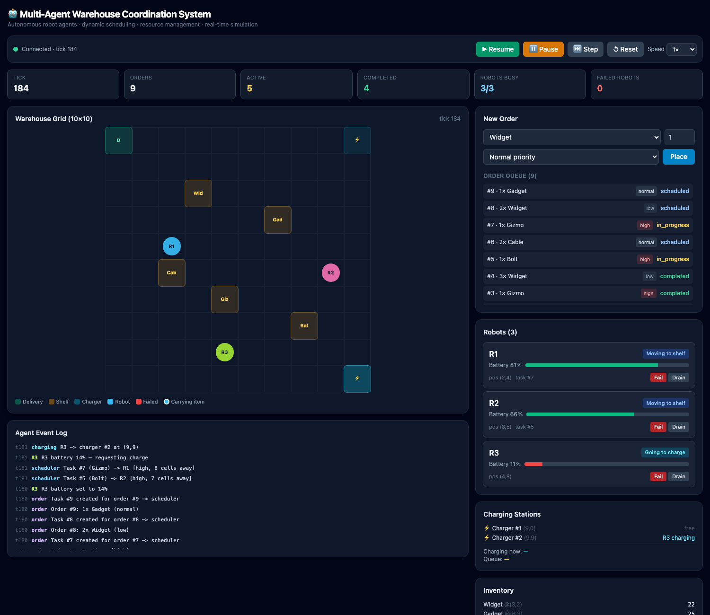

# 🤖 Multi-Agent Warehouse Robot Coordination System

A **Multi-Agent Systems (MAS)** simulation for warehouse automation, built for
**MRO12 – Multi-Agent Systems**. Multiple autonomous warehouse robots
coordinate to fulfil orders: they accept tasks, navigate a 2-D grid, pick and
deliver items, manage their own batteries, and recover from failures — all
driven by independent agents communicating over a REST/WebSocket API and
orchestrated with n8n.



---

## MAS concepts demonstrated

| MAS Concept | Where it lives |
|-------------|----------------|
| **Autonomous agents** | Each robot is a `RobotAgent` running its own state machine ([robot_agent.py](backend/agents/robot_agent.py)) |
| **Coordination** | `SchedulerAgent` assigns work and rebalances ([scheduler_agent.py](backend/agents/scheduler_agent.py)) |
| **Communication** | Shared event bus + REST + WebSocket + n8n ([events.py](backend/services/events.py)) |
| **Dynamic decision making** | Nearest-robot, battery-aware, priority-first task allocation |
| **Resource management** | `ChargingAgent` manages limited charging stations ([charging_agent.py](backend/agents/charging_agent.py)) |
| **Conflict resolution** | Charging queue + cell-collision avoidance + task reassignment |
| **Event-driven architecture** | n8n workflows + tick loop ([engine.py](backend/simulation/engine.py)) |
| **Adaptation** | Battery-aware scheduling, failure recovery, auto-replenishment |

---

## Architecture

```
                      ┌─────────────┐
   New Order  ───────▶│ Order Agent │ validates stock, creates task
                      └──────┬──────┘
                             ▼
                      ┌───────────────┐   picks best robot (priority, distance, battery)
                      │ Scheduler     │◀──── monitors for failures, re-queues tasks
                      └──────┬────────┘
                             ▼
        ┌────────────────────────────────────────┐
        │  Robot Agents  R1   R2   R3  …           │  navigate · pick · deliver · charge
        └───────┬───────────────────────┬─────────┘
                ▼                        ▼
        ┌────────────────┐      ┌──────────────────────┐
        │ Inventory Agent│      │ Charging Station Agent│
        │ stock/location │      │ queues, no conflicts  │
        └────────────────┘      └──────────────────────┘
                             ▼
                       Order Complete
```

Full write-up in [docs/architecture.md](docs/architecture.md).

---

## Quick start

### Option A — Docker (everything at once)

```bash
docker compose up --build
```

| Service | URL |
|---------|-----|
| Dashboard | http://localhost:5173 |
| Backend API + Swagger docs | http://localhost:8000/docs |
| n8n | http://localhost:5678 |

### Option B — Local development

**Backend**
```bash
python3 -m venv .venv
source .venv/bin/activate
pip install -r requirements.txt
python -m backend.main          # or: uvicorn backend.api.app:app --reload
```
Backend runs on http://localhost:8000 and the simulation starts ticking
immediately.

**Frontend**
```bash
cd frontend
npm install
npm run dev                      # http://localhost:5173
```

---

## REST API

Interactive docs at `/docs`. Summary:

| Resource | Method | Endpoint | Purpose |
|----------|--------|----------|---------|
| Orders | `POST` | `/orders` | Create an order (item, quantity, priority) |
| | `GET` | `/orders` | List orders |
| Robots | `GET` | `/robots` | List robots and live status |
| | `POST` | `/robots/{id}/assign` | Manually assign a pending task |
| | `POST` | `/robots/{id}/status` | Break / repair a robot, set battery |
| Tasks | `GET` / `POST` | `/tasks` | List / create tasks |
| Inventory | `GET` | `/inventory` | Stock levels and shelf locations |
| | `POST` | `/inventory/update` | Adjust stock (`delta` or absolute `stock`) |
| State | `GET` | `/state` | Full world snapshot |
| Events | `GET` | `/events` | Agent action log |
| Sim ctl | `POST` | `/sim/{pause,resume,step,reset,speed}` | Control the simulation |
| Live | `WS` | `/ws` | Real-time state + event stream |

Example:
```bash
curl -X POST localhost:8000/orders \
  -H 'Content-Type: application/json' \
  -d '{"item":"Widget","quantity":2,"priority":"high"}'
```

---

## Simulation rules

- **Grid**: 10×10 cells. Shelves, two charging stations, and one delivery zone
  are fixed cells.
- **Movement**: 1 cell per tick (1 s by default), greedy pathing with
  robot–robot collision avoidance.
- **Battery**: −1% per move; a robot heads to a charger when below 20% and
  charges back to 100%.
- **Conflicts**: no two robots occupy the same cell; only one robot per charger
  (others queue).
- **Failure**: a robot can be "broken" at any time — the scheduler returns its
  task to the queue and another robot finishes the job.

Tune everything via environment variables — see [.env.example](.env.example).

---

## Demo script (for the presentation)

1. **Live order creation** — place a few orders from the dashboard.
2. **Scheduling** — watch the Scheduler assign them to the nearest free robots
   in the event log.
3. **Movement & delivery** — robots drive to shelves, pick (📦), and deliver.
4. **Battery & charging** — hit **Drain** on a robot; it autonomously queues
   for a charger when one is busy (conflict resolution).
5. **Failure & reassignment** — hit **Fail** on a robot mid-task; its order is
   re-assigned and still completes.
6. **Concurrency & priority** — flood high-priority orders and watch multiple
   robots work in parallel, high priority first.

---

## Project structure

```
warehouse-mas/
├── backend/
│   ├── agents/           # order, scheduler, robot, inventory, charging agents
│   ├── api/              # FastAPI app + schemas
│   ├── database/         # SQLite layer + warehouse.db
│   ├── services/         # event bus
│   ├── simulation/       # world model + tick engine
│   ├── config.py         # env-driven settings
│   └── main.py           # entry point
├── frontend/             # React + Vite + Tailwind dashboard
├── n8n/                  # workflows + compose
├── docs/                 # architecture + screenshots
├── docker-compose.yml
└── requirements.txt
```

---

## Tech stack

Python 3.12 · FastAPI · SQLite · React + Vite + TailwindCSS · n8n · Docker.

## Future improvements

ROS2 / Gazebo 3-D simulation · SLAM · reinforcement-learning scheduling ·
multi-floor warehouses · swarm intelligence.
